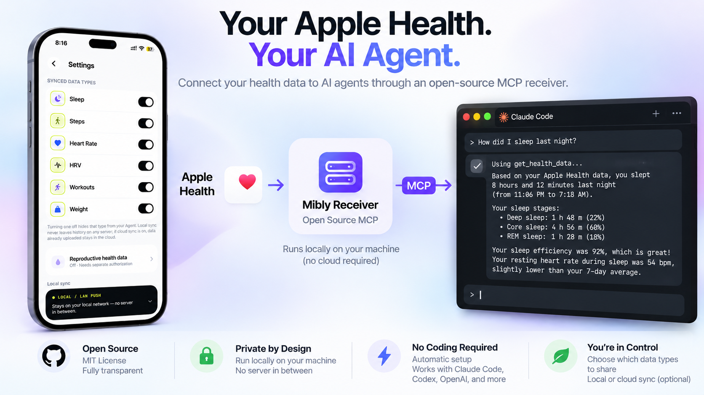

[English](README.md) · [简体中文](README.zh-CN.md) · **日本語**

[](https://apps.apple.com/us/app/mibly-health-data-for-ai/id6812404098)
[](https://github.com/littlenew117/mibly-apple-health-mcp/releases)
[](https://github.com/littlenew117/mibly-apple-health-mcp/actions/workflows/ci.yml)
[](LICENSE)
[](https://modelcontextprotocol.io)
[](https://mibly.app)
[](https://glama.ai/mcp/servers/littlenew117/mibly-apple-health-mcp)
[](https://mcpservers.org/servers/littlenew117/mibly-apple-health-mcp)

> 内容は英語版 [README.md](README.md) が正です。

# Apple Health MCP — Mibly Receiver

オープンソースの **Apple Health MCP サーバー**です。Apple ヘルスケア(HealthKit)のデータ——睡眠、歩数、心拍数、HRV、ワークアウト、体重、体脂肪など——を、Claude Desktop/Code、Codex、またはご自身で構築・運用するあらゆる AI(MCP に対応していればOK)で使えるようにします。

**Local モード:あなたのデータが Mibly のサーバーを通ることはありません。** アカウント不要、クラウドなし、テレメトリなし。データはあなたが管理するマシン上に暗号化して保存され、このリポジトリがそのためのコードです。

## いちばん簡単な始め方

1. iPhone で **Mibly をダウンロード** → [App Store](https://apps.apple.com/us/app/mibly-health-data-for-ai/id6812404098)
2. Mibly アプリ内(接続設定 →「AI用にコピー」)から **セットアップ用プロンプトをコピー**して、お使いの AI に貼り付けます。

AI が Receiver と MCP サービスをセットアップします。クローンもビルドも設定ファイルの編集も不要です。

## なぜ iPhone アプリが必要?

Apple ヘルスケアのデータは、ネイティブ iOS アプリ内で HealthKit を通してのみ読み取れます。Web API はありません。Mibly が権限、バックグラウンド同期、データ整形といった HealthKit 側を担当するので、Apple Developer アカウントも Xcode も必要ありません。

## このリポジトリについて

AI がインストールする Receiver の参考実装です。次のことができるように公開しています。

- あなたのマシンで何が動き、データがどこへ行くのかを **確認** する
- 必要なら **カスタマイズ** する

Mibly を使うのにこのコードは必要ありません。上記のセットアップ用プロンプトを使う方法をおすすめします。

## データはどこへ行く?

| 質問 | 回答 |
|---|---|
| ヘルスデータの保存先は? | `~/.mibly/data.enc` のみ。AES-256-GCM、鍵 = scrypt(ペアリングトークン, ランダムな salt)。 |
| サービスは外部へ通信しますか? | いいえ。待ち受けるだけです。テレメトリも更新チェックもありません。 |
| ネットワーク経由で読めるのは誰? | ペアリングトークンを持つ人。すべてのルートで `Authorization: Bearer <token>` が必要です。 |
| どのくらい保持される? | 365日分の履歴。種類ごとの最新1件のみ、それより長く保持されます。 |
| 通信は暗号化される? | **いいえ。** Local モードは自宅やオフィスの LAN 向けの設計です。iPhone とこの Receiver が同じ Wi-Fi 上で平文 HTTP で通信します。ポートをインターネットに公開しないでください。 |

ご自身で確認できます。次のコマンドは何も出力しないはずです。

```sh
grep -rnE "fetch\(|https?\.request|axios|net\.connect|XMLHttpRequest" src
```

通信プロトコル(エンドポイント、ペイロード、保存形式)は [PROTOCOL.md](PROTOCOL.md)、脅威モデルは [SECURITY.md](SECURITY.md) をご覧ください(いずれも英語)。

## 自分で動かす

Node.js 18 以上が必要です。

```sh
npm ci
npm run build
MIBLY_TOKEN=<token from the Mibly app> npm start
```

初回起動時にトークンが `~/.mibly/config.json`(パーミッション 0600)に保存されるので、次回以降は環境変数は不要です。起動時に使用するアドレスが表示されます(例:`Target Host to enter in Mibly: 192.168.1.24:7345 (en0)`)。これをアプリの「接続先ホスト」(Target Host)欄に入力してください(`IP:ポート` のみ。`http://` やパスは不要)。複数表示された場合は、Wi-Fi/LAN 側のアドレスを選びます。

| 変数 | 意味 | デフォルト |
|---|---|---|
| `MIBLY_TOKEN` | アプリのペアリングトークン | 保存済みの設定 |
| `MIBLY_HOST` | バインドアドレス `host:port` | `0.0.0.0:7345` |

MCP クライアントは `http://<ip>:7345/mcp` に HTTP で接続し、ヘッダー `Authorization: Bearer <token>` を付けます。stdio で MCP サーバーを起動する AI の場合は `--stdio` を追加します(ログは stderr に出力されます)。

アプリでトークンを再生成した場合は、新しい `MIBLY_TOKEN` で再起動してください。古い暗号化データは新しい鍵では復号できないため、Receiver は空の状態から始まります。

コードの構成:`src/index.ts`(ルート)· `src/auth.ts`(トークン検証)· `src/config.ts`(`~/.mibly/config.json`)· `src/ingest.ts`(検証)· `src/store.ts`(暗号化、保持、クエリ)· `src/mcp.ts`(2つのツール)。テストは `npm test` で実行します。

## 起動時に自動で立ち上げる

再起動後も Receiver が動き続けるようにします。パス(Linux ではユーザー名も)はご自身のものに置き換えてください。トークンは `~/.mibly/config.json` に保存済みなので、環境変数は不要です。

**macOS(launchd)** — `~/Library/LaunchAgents/com.mibly.receiver.plist`:

```xml
<?xml version="1.0" encoding="UTF-8"?>
<!DOCTYPE plist PUBLIC "-//Apple//DTD PLIST 1.0//EN" "http://www.apple.com/DTDs/PropertyList-1.0.dtd">
<plist version="1.0"><dict>
  <key>Label</key><string>com.mibly.receiver</string>
  <key>ProgramArguments</key><array>
    <string>/usr/local/bin/node</string>
    <string>/Users/you/mibly-apple-health-mcp/dist/index.js</string>
  </array>
  <key>RunAtLoad</key><true/>
  <key>KeepAlive</key><true/>
</dict></plist>
```

```sh
launchctl bootstrap gui/$(id -u) ~/Library/LaunchAgents/com.mibly.receiver.plist
```

**Linux(systemd)** — `/etc/systemd/system/mibly-receiver.service`:

```ini
[Unit]
Description=Mibly receiver
After=network-online.target
Wants=network-online.target

[Service]
User=you
ExecStart=/usr/bin/node /home/you/mibly-apple-health-mcp/dist/index.js
Restart=always

[Install]
WantedBy=multi-user.target
```

```sh
sudo systemctl enable --now mibly-receiver
```

マシンを再起動し、`/status` で Receiver が戻っていることを確認します(IP は Receiver が起動時に表示したものを使います)。

```sh
curl -H "Authorization: Bearer <token>" http://<ip>:7345/status
```

`version` と `lastPushAt` を含む JSON が返れば、動作しています。

## 旧バージョンからのアップグレード

その場で更新してください。2 つ目の Receiver は作りません。

1. 新しいコードを取得し、`npm ci && npm run build` を実行して、サービスを再起動します。
2. **トークンとデータは保持します。** `~/.mibly` を削除したり、トークンを変えたりしないでください。トークンを変えると空の状態から始まります。
3. 旧形式の `heartRate` レコード(`heartRateSummary` のない単発の測定値)は、`heartRate` が 1 時間ごとの集計になったため、起動時に削除されます。それ以外のデータはすべて保持されます。
4. `GET /status` を確認します。新しい `version` と `capabilities` が表示されるはずです。

Mibly アプリの新機能には、対応するバージョンの Receiver が必要です。古いアプリは新しい Receiver でも引き続き使えます。

## Local と Cloud

| | Local(無料) | Cloud(Pro) |
|---|---|---|
| データの経路 | iPhone → 自分で管理する AI の環境 | iPhone → Mibly Cloud → あなたの AI |
| デバイスをまたぐリモートアクセス | — | ✓ |
| 同じデータを複数の AI で利用 | — | ✓ |
| 生理周期データ | 利用可(デフォルトはオフ) | アップロードされません |

このリポジトリは Local のみを対象としています。共有するデータの種類を選べ、いつでも種類ごとにオフにできます。

## 注意事項

- Mibly は診断や医療上の判断を行いません。あなたが共有を選んだデータに AI がアクセスできるようにするだけです。
- このリポジトリの Issue は Receiver のコードに関するものに限ります。アプリのサポートは [mibly.app](https://mibly.app/) をご覧ください。
- プライバシーポリシー:https://mibly.app/privacy/

## ライセンス

MIT
